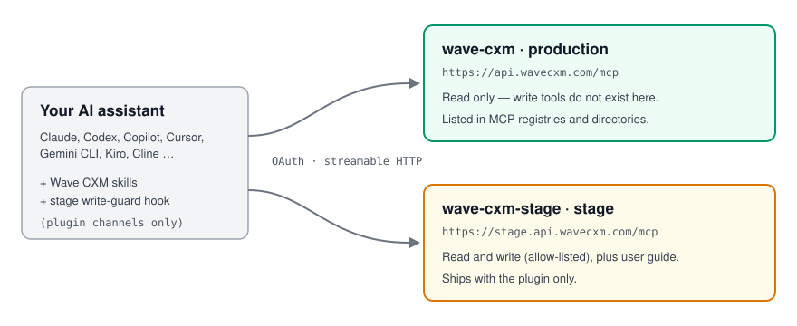

# Wave CXM

**Verify, diagnose, map and author [Wave CXM](https://go.wavecxm.com) loyalty configuration from your AI assistant.**

Wave CXM is a customer-experience and loyalty platform: campaigns, rules, reward schemes, redemption options, coupon groups and contests. This plugin connects your assistant to it and adds the workflows that make that connection useful:

- **Verify** configuration before it goes live.
- **Diagnose** why something misbehaved, from what actually happened.
- **Map** an unfamiliar tenant, including what your permissions hide.
- **Author** configuration by conversation, on stage only.

It serves engineers working on Wave CXM, and product, support, customer-success and onboarding teams who use the assistant as a read-only console over their own tenants.



## Install

| Runtime | Install |
| ------- | ------- |
| Claude Code | `claude plugin marketplace add Desquared/AI-Marketplace` then `claude plugin install wave-cxm@desquared` |
| GitHub Copilot CLI | `copilot plugin marketplace add Desquared/AI-Marketplace` then `copilot plugin install wave-cxm@desquared` |
| OpenAI Codex | `codex plugin marketplace add Desquared/AI-Marketplace`, then enable **Wave CXM** under `/plugins` |
| Cursor | Install **Wave CXM** from the Cursor Marketplace |
| Gemini CLI | `gemini extensions install https://github.com/Desquared/AI-Marketplace` |
| Kiro | **Powers** → **Add Custom Power** → **Import from GitHub** → `https://github.com/Desquared/AI-Marketplace/tree/main/plugins/wave-cxm` |

After installing, reload plugins or restart the session so the MCP servers register. Using only the MCP server, with no skills? See [Use the MCP server directly](../../README.md#use-the-mcp-server-directly).

## Sign in

The plugin ships **no credentials**. Each connector signs you in the first time it is used: your assistant opens a browser, you sign in to Wave CXM, then choose which tenants and permissions to grant.

- **Sign-in needs an interactive session.** A headless run cannot complete the browser flow.
- **Each connector signs in separately.** Granting stage does not grant production.
- **Consent is per tenant and per permission**, and revocable at any time from **Authorized apps** in Wave CXM.

You never create, paste or store an API key.

## The two connectors

| Connector | Environment | Endpoint | Can do |
|:----------|:------------|:---------|:-------|
| `wave-cxm` | production | `https://api.wavecxm.com/mcp` | Read only. The write tools **do not exist** on this connector. |
| `wave-cxm-stage` | stage | `https://stage.api.wavecxm.com/mcp` | Read and write (allow-listed types), plus the product user guide. |

**Production cannot be written to.** Not by policy: the tools are absent. Nothing you or the assistant does through this plugin changes production configuration.

**A tenant id does not tell you the environment.** The same tenant can exist on both connectors with the same id and different data. Only the connector tells them apart, so every skill prints its environment and tenant in its output header.

Every request is scoped to the tenant you name and to what your role allows. The assistant sees what you would see in the admin panel, and nothing else. Archived records are never returned.

## Skills

| Skill | Use it when |
|:------|:------------|
| `verify-config` | Something is about to go live and you want to know it is right. Inspects configuration only. |
| `diagnose-issue` | Something already misbehaved and you need the cause. Reads what actually happened. |
| `tenant-map` | You are new to a tenant: what is in it, what is live, what changed, what your permissions hide. |
| `author-config` | You want to create, change or remove configuration. Stage only. |

Skills trigger from your description of the problem. To be explicit, name one:

```
/wave-cxm:verify-config the Summer 2026 campaign
```

A fifth skill, `wave-cxm-context`, holds the access rules the others follow and is not invoked directly.

## Try it

> Which Wave CXM tenants can I act on?

You should get your tenants and your permissions in each. Then:

> Give me a map of the Acme tenant.

Replace `Acme` with a tenant from the previous answer.

## What the plugin runs and sends

- **Network:** HTTPS requests to `api.wavecxm.com` and `stage.api.wavecxm.com` only, through the MCP streamable HTTP transport (POST), and the Wave CXM sign-in pages your browser opens.
- **Data sent:** the tool calls your assistant makes (tenant, entity type, filters, and for stage writes the fields being set) with your OAuth access token.
- **Hooks:** two non-blocking reminders on the stage write tools. Each prints a line of text and runs no other program.
- **Skills and rules:** plain instructions to the assistant, with no code and no credentials.
- **Nothing else:** no telemetry, no local files written, no environment variables read.

## Troubleshooting

**No sign-in prompt, or the browser never opens.** The client may have cached an earlier connection. Restart it fully and sign in again, or remove and re-add the connector. A client that cannot follow the server's sign-in challenge reports a plain `Unauthorized` instead of opening a browser.

**`Unauthorized` after it was working.** The sign-in expired or was revoked. Sign in to the connector again.

**"Method not allowed", or the connection stalls.** The connector accepts `POST` only, over the streamable HTTP transport. A client configured for the older SSE transport will not connect.

**Empty results.** Either there are no matching records, or your role cannot view that record type. The skills check which; if you query the MCP directly, check your permissions in `list_tenants` first.

**The consent screen offers nothing to grant.** You have no permissions in any tenant on that environment, or you signed in with the wrong account.

## Support, privacy and terms

- **Support:** [open an issue](https://github.com/Desquared/AI-Marketplace/issues). For security issues, follow [SECURITY.md](../../SECURITY.md); never report them in a public issue.
- **Privacy:** [TO BE COMPLETED: link to the Wave CXM privacy policy]
- **Terms:** [TO BE COMPLETED: link to the Wave CXM terms of service]

The plugin is a client. The data it reaches lives in the Wave CXM service, which processes it as described in the Wave CXM privacy policy, including what the MCP servers log, how long they keep it, and how to ask for deletion.

- **Your sign-in** gives the assistant your own role in the tenants you choose, and nothing more. Revoke it any time from **Authorized apps** in Wave CXM.
- **Tool results enter your AI client.** Whatever the MCP servers return is placed in the assistant's context and handled by your AI client provider under that provider's own terms and privacy policy, not Desquared's. Check them before querying personal data.
- **Personal data.** Loyalty records can include members' personal data. Query only what the task needs, and follow your organisation's data-protection rules for what you paste or keep.

## Trademarks

Wave CXM is a Desquared product; see the [license](LICENSE.md) (Section 6) for use of its names and logos. Claude, Claude Code, ChatGPT, Codex, GitHub Copilot, Cursor, Kiro, Gemini, Cline and other product names are trademarks of their respective owners. They are used here only to say which clients the plugin works with, and their use implies no affiliation with or endorsement by those owners.

## License

Copyright © 2026 Desquared. All rights reserved. Use is governed by the [Desquared Proprietary License](LICENSE.md): you may install and run the plugin as published, but not modify or redistribute it. The hosted Wave CXM service is governed by its own terms of service.
